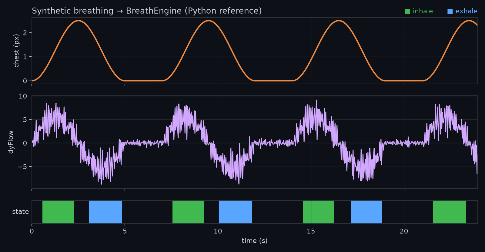
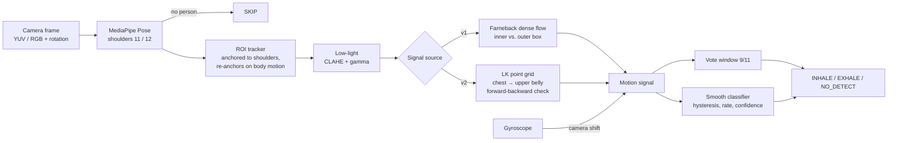

# BreathEngine

[](https://github.com/idandebi/BreathEngine/actions/workflows/ci.yml)


**BreathEngine detects breathing from an ordinary phone camera. It needs no
wearable and no extra sensor.** On every frame it tells you whether the user
is **inhaling**, **exhaling** or holding. It also reports a continuous breath
signal, breaths per minute, and separate **chest** and **belly** motion.

It is a portable **C++17 core** with a stable **C API**. On top of it sit an
**Android SDK** (CameraX + MediaPipe + JNI, one line to start a session) and a
**Python reference implementation** that the core is tested against frame by
frame.

<p align="center">
  
</p>

<sub>The figure shows a 2.5 px chest movement with sensor noise, run through
the engine. It is regenerated by `python/tools/make_figure.py`.</sub>

---

## Highlights

- **Sub-pixel motion sensing.** Breathing moves the chest by only a few
  pixels. The engine measures it with dense optical flow or tracked feature
  grids, then rejects outliers robustly.
- **Body-anchored ROI.** MediaPipe pose finds the shoulders. The analysed
  region is anchored to them and re-anchors only when the body actually moves,
  so measurement follows breathing rather than posture.
- **Chest vs. belly.** The v2 point grid spans the chest down to the upper
  belly and reports both halves separately (`dy_chest`, `dy_belly`). That is
  the basis for coaching diaphragmatic breathing.
- **Two classifiers.** The original 9-of-11 vote window, and a time-based
  smooth classifier with hysteresis. The smooth classifier is
  fps-independent, gives a 0–1 confidence, and counts breaths and breath rate.
- **Hand-held ready.** Gyroscope camera-motion compensation subtracts the
  phone's own shake and flags frames that cannot be measured.
- **Guided breathing.** An optional guide segment (inhale / hold / exhale /
  hold) validates the user against a pattern such as box breathing 4-4-4-4.
- **One core, many platforms.** A plain C API: no exceptions or STL across the
  boundary, and the caller owns all memory. It accepts RGB/BGR/RGBA/BGRA/NV21/NV12
  with rotation. It needs only OpenCV `core`, `imgproc` and `video`.
- **Verified port.** A parity harness runs the C++ core and the Python
  reference on the same synthetic scenarios. It requires identical ROI and
  re-anchor decisions and at least 99 % identical states. With the same
  OpenCV build on both sides the match is bit-exact (100 %). CI runs it on
  every push.

## How it works



The full specification, with exact parameters, ROI geometry and edge cases,
is in [`docs/ALGORITHM.md`](docs/ALGORITHM.md).

## Repository layout

```
cpp/                     C++17 core
  include/breath_engine/   breath_engine.h  - stable C API
  src/                     engine (ROI, flow, LK grid, classifiers), C API
  tests/                   unit tests (185 checks)
  tools/parity.cpp         frame-by-frame parity runner
android/
  breathengine/            Android library (AAR): CameraX + MediaPipe + JNI
  sample/                  demo app: live overlay, signal graph, session logging
python/
  breath_engine/           reference implementation (OpenCV + MediaPipe)
  tests/                   unit + synthetic-motion tests
  tools/                   live webcam runner, parity check, log analysis
docs/ALGORITHM.md        algorithm specification
models/                  MediaPipe pose model
```

## Quick start

### Android

```kotlin
// Camera + pose + engine; results arrive on the main thread.
val session = BreathSession(context, lifecycleOwner, previewView) { r ->
    label.text = r.state.name          // INHALE / EXHALE / NO_DETECT / SKIP
    meter.progress = r.confidence      // 0..1
}
session.start()                        // needs the CAMERA permission
session.guideSegment = GuideSegment.INHALE   // optional: follow a breathing guide
session.close()
```

You can plug in at any level. `BreathAnalyzer` is a CameraX `ImageAnalysis.Analyzer`
for your own pipeline, and `BreathEngine().process(bitmap, shoulders)` takes
your own frames and pose.

```bash
cd android
./gradlew :sample:installDebug         # builds the AAR + demo app and installs it
```

### C / C++

```c
#include <breath_engine/breath_engine.h>

be_config cfg = be_default_config();
cfg.signal_source = BE_SIGNAL_GRID;          // chest + belly point grid
cfg.classifier    = BE_CLASSIFIER_SMOOTH;
be_engine* eng = be_create(&cfg);

be_image img = { y, width, height, y_stride, BE_FORMAT_NV21, 90 /* rotation */, vu, vu_stride };
be_shoulders s = { lx, ly, rx, ry, 1 };      // from your pose detector
be_result r;
be_process(eng, &img, &s, BE_GUIDE_NONE, timestamp_ms, &r);
// r.state, r.signal, r.dy_chest, r.dy_belly, r.breath_rate_bpm, r.confidence ...

be_destroy(eng);
```

```bash
# Linux / macOS (OpenCV installed)
cmake -S cpp -B cpp/build -DCMAKE_BUILD_TYPE=Release
cmake --build cpp/build -j && ctest --test-dir cpp/build

# Windows (OpenCV 4.10 extracted to third_party/opencv)
cmake -S cpp -B cpp/build -G "Visual Studio 17 2022" -A x64 -DOpenCV_DIR=third_party/opencv/build
cmake --build cpp/build --config Release
```

### Python reference

```bash
cd python
pip install -r requirements.txt
python -m pytest -q tests

python tools/run_live.py                      # webcam with overlay
python tools/run_live.py --pattern 4-4-4-4    # with a box-breathing guide
```

```python
from breath_engine import BreathEngine, Shoulders
engine = BreathEngine()
result = engine.process(frame_rgb, Shoulders(left_px, right_px))
result.state, result.dy_flow
```

Sit facing the camera with your shoulders in view. The green box is the
analysed region. It flashes red when you move and it re-anchors.

## Testing

| Layer | What is checked |
|---|---|
| C++ core | 185 unit checks: ROI geometry and rounding, re-anchoring, vote and smooth classifiers, LK grid placement and coverage, camera-motion compensation, image formats and rotation |
| Python reference | Classifier rules, guide validation, synthetic sub-pixel breathing cycles, fps independence |
| Parity | C++ vs. Python on synthetic scenarios: identical ROI and re-anchor decisions, ≥ 99 % identical states (bit-exact with the same OpenCV build) |
| Android | The AAR and the sample app are built in CI, and the APK is attached to each run |

## Roadmap

- [x] Python reference implementation and desktop runner
- [x] C++ core + C API, unit tests, parity with the reference
- [x] Android SDK + demo app (CameraX, MediaPipe Tasks, JNI)
- [x] v2 signal: chest/belly point grid, smooth classifier, gyro compensation
- [ ] iOS (AVFoundation + MediaPipe Tasks + the same C core)
- [ ] React Native / Flutter bindings
- [ ] Accuracy benchmark against a respiration belt

## License

Copyright © 2026 idandebi. All rights reserved. The source is published for
viewing and evaluation; see [LICENSE](LICENSE). The bundled MediaPipe pose
model is Apache-2.0.
